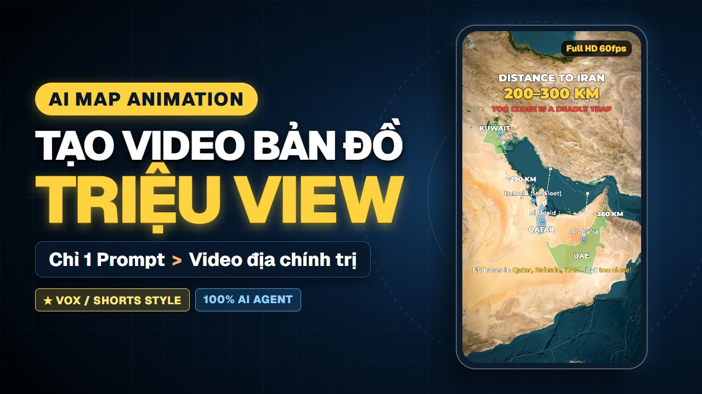
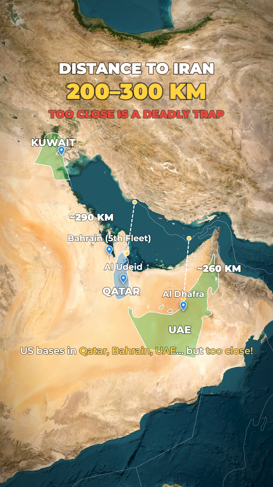

# AI Map Animation 🌍✨

> Turn text prompts and voiceovers into cinematic, Vox/Johnny Harris-style vertical map explainer videos with satellite terrain, smooth camera zooms, and animated borders.



[](https://opensource.org/licenses/MIT)
[](https://nodejs.org/)
[](https://playwright.dev/)
[](https://ffmpeg.org/)

---

## 🌟 Overview

**AI Map Animation** is a deterministic, code-driven video engine designed for creating high-retention map explainers for **YouTube Shorts, TikTok, and Instagram Reels** (1080×1920 9:16 vertical video).

Powered by headless Chromium (Playwright) and deterministic SVG/Canvas rendering, every frame is rendered with sub-pixel precision and compiled into fluid 60fps MP4 videos via FFmpeg.



### Key Features

- 🗺️ **Real Geographic Borders**: Pre-bundled with Natural Earth 1:50m world countries, admin-1 provinces (US, Canada, China, India, Australia, Brazil, Russia, etc.), and US states 1:10m.
- 🏔️ **Satellite & Relief Terrain Support**: Georeference custom satellite imagery (Google Earth, Esri, NASA, Mapbox) with control points (`[px, py, lng, lat]`).
- 🎯 **Vox / Geopolitics Visual Grammar**:
  - Country, province, and territory color fills with glowing borders.
  - Animated flight paths, shipping lanes, and missile ballistic trajectories.
  - Measurement lines with dynamic distance labels (e.g. `~290 KM`).
  - Military radar pulses, combat radius circles, warning zones, and base pins.
  - Country flag shields, aircraft icons, and blueprint cutaways.
- 🔊 **Automated SFX Synchronization**: Built-in sound effects library (`whoosh`, `pop`, `click`, `impact`, `riser`, `ding`) triggered automatically on shot transitions and element appearances.
- 🎙️ **Voiceover & Word-Level Timing**: Integrated with Whisper (`faster-whisper`) for precise audio-visual synchronization.
- 🔤 **Vietnamese & Global Typography**: Pre-packaged with clean fonts (`BeVietnamPro`, `Montserrat`, `Poppins`) supporting full Vietnamese diacritics and bold readability on mobile screens.

---

## 🚀 Quick Start

### 1. Prerequisites
- **Node.js 18+**
- **FFmpeg** (accessible in PATH)
- **Python 3.10+** (optional, for automatic voiceover timestamping)

### 2. Installation

#### Windows (PowerShell):
```powershell
powershell -ExecutionPolicy Bypass -File setup.ps1
```

#### macOS / Linux:
```bash
bash setup.sh
```

#### Manual:
```bash
npm install
npx playwright install chromium
pip install -r requirements.txt
```

### 3. Test Render

Render a quick preview of the built-in demo scene (3 seconds, half scale):
```bash
node scripts/render.mjs examples/demo.json output.mp4 --scale 0.5 --to 3
```

---

## 🎬 How It Works

A video is defined as a declarative `scene.json` file specifying camera movements, shots, elements, and audio:

```json
{
  "title": "Geopolitical Explainer",
  "width": 1080,
  "height": 1920,
  "fps": 60,
  "projection": "orthographic",
  "audio": "audio/voiceover.mp3",
  "music": "audio/bg_music.mp3",
  "musicVolume": 0.08,
  "shots": [
    {
      "start": 0.0,
      "end": 4.5,
      "cam": {
        "from": { "center": [50.0, 26.0], "zoom": 1.2 },
        "to": { "center": [51.5, 25.3], "zoom": 3.8, "ease": "cubic-out" }
      },
      "elements": [
        {
          "type": "highlight",
          "country": "QAT",
          "color": "#3f9de8",
          "t": 0.5
        },
        {
          "type": "dist",
          "from": [51.5, 25.3],
          "to": [52.8, 27.5],
          "label": "~260 KM",
          "color": "#ffd23f",
          "t": 1.2
        }
      ]
    }
  ]
}
```

### Render Options

| Flag | Description | Example |
|---|---|---|
| `--scale <n>` | Render at fractional resolution for fast previews | `--scale 0.5` |
| `--still <t>` | Render a single still frame at timestamp `t` (seconds) | `--still 2.5` |
| `--contact <n>`| Render a contact sheet with a frame every `n` seconds | `--contact 2` |
| `--from <t>` | Start rendering at timestamp `t` | `--from 5.0` |
| `--to <t>` | Stop rendering at timestamp `t` | `--to 12.0` |
| `--workers <n>`| Parallel Chromium browser page count | `--workers 4` |

---

## 📂 Project Structure

```
ai-map-animation/
├── assets/
│   ├── fonts/         # BeVietnamPro, Montserrat, Poppins
│   └── sfx/           # Pop, whoosh, click, impact sound effects
├── engine/
│   ├── engine.js      # Core SVG/Canvas renderer & animation system
│   ├── geo.js         # Bundled Natural Earth borders & TopoJSON
│   └── index.html     # Headless browser container
├── examples/
│   ├── demo.json      # Built-in globe demonstration
│   └── midterms.json  # Georeferenced multi-shot example
├── references/
│   ├── elements.md    # Complete reference of all JSON elements
│   └── style-guide.md # Vox/Shorts visual grammar & highlight rules
├── rights/            # Licensing and data attribution
├── scripts/
│   ├── render.mjs     # CLI: scene JSON -> MP4 / still frames
│   ├── georef.mjs     # Visual verification of control points
│   ├── timestamps.py  # Audio -> word timestamps via Whisper
│   ├── make_sfx.py    # SFX generator utility
│   └── autoalign.py   # Automatic coastline image snapping
├── package.json
├── requirements.txt
├── setup.ps1
└── setup.sh
```

---

## 🎨 Supported Visual Elements

Refer to [`references/elements.md`](references/elements.md) for full syntax and options:

- **Highlight**: Highlights countries, US states, or admin-1 provinces with colored fills and illuminated borders.
- **Path**: Great-circle animated curved routes (air routes, trade lanes, missile arcs).
- **Dist**: Straight-line measurement between coordinates with real-world distance calculation and animated endpoints.
- **Marker**: Location pins, military icons, ship symbols, or custom icons.
- **Flag**: Country flag shields with clean 3D border shadows.
- **Label**: Kinetic typography with contrast shadows and keyword emphasis.
- **Radar**: Military concentric pulsing radar sweeps.
- **Cutaway / Infographic**: Split-screen blueprints, cross-section diagrams, and comparison stats.

---

## 📄 License & Attribution

- **Engine & Scripts**: MIT License. See [LICENSE](LICENSE) for details.
- **Geographic Data**: [Natural Earth](https://www.naturalearthdata.com/) vector boundaries (Public Domain).
- **Libraries**: [topojson-client](https://github.com/topojson/topojson-client) (ISC License).
- **Fonts**: [Poppins](https://fonts.google.com/specimen/Poppins) & [Be Vietnam Pro](https://fonts.google.com/specimen/Be+Vietnam+Pro) (SIL Open Font License 1.1).

---

Made with ❤️ by [Devxin](https://github.com/lovesickness111).
